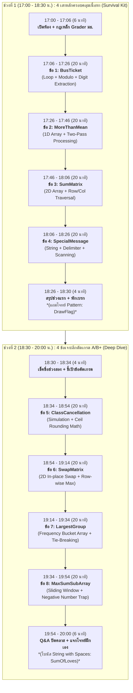

# แผนการสอนและคัดเลือกโจทย์ติวสอบ Grader วิชา คพ.102 (CS102) [ฉบับปรับปรุง 4 ข้อ/ช่วง]

เอกสารฉบับนี้จัดทำขึ้นเพื่อเป็นแนวทางการสอนสำหรับติวเตอร์ในการติวน้องนักศึกษาชั้นปีที่ 1 ใน **ห้องบรรยายใหญ่ (Large Lecture Room)** โดยแบ่งเวลาออกเป็น 2 ช่วง ช่วงละ 4 ข้อ (รวม 8 ข้อหลัก + 2 ข้อโบนัส) เน้นการให้เวลา **น้องพิมพ์โค้ดตามจริง (Code-along) และมีพี่ TA เดินประกบตอบคำถาม**

---

## 1. ยุทธศาสตร์การสอนแบบ "12 + 8 นาทีต่อข้อ"

เวลา 90 นาทีต่อช่วง เหมาะสมที่สุดสำหรับการสอน **4 ข้อ** โดยในแต่ละข้อแบ่งเวลา 20 นาทีอย่างเป็นระบบ:

```text
┌────────────────────────────────────────────────────────────────────────┐
│                        เวลา 20 นาทีต่อข้อ                              │
├─────────────────────────────────────────┬──────────────────────────────┤
│    ติวเตอร์นำบนเวที (12 นาที)           │   น้องลงมือทำ + TA (8 นาที)  │
│  - แกะโจทย์ + วาด Logic (4 นาที)        │ - น้องพิมพ์ตามใน Starter     │
│  - Live Coding สดบนจอ (6 นาที)          │ - พี่ TA เดินตอบข้อสงสัย     │
│  - ชี้จุดดัก Grader ได้ 0 (2 นาที)      │ - สรุป Key Takeaway (1 นาที) │
└─────────────────────────────────────────┴──────────────────────────────┘
```

---

## 2. ตารางแผนการสอนภาพรวม 2 ช่วงเวลา (4 + 4 ข้อ)



---

## 3. ช่วงที่ 1: 17.00 – 18.30 น. (4 เสาหลักครอบคลุม 100%)

> **เป้าหมาย:** น้องที่จำเป็นต้องกลับบ้านตอน 18.30 น. จะได้เห็นแนวคิดครบทั้ง 4 เสาหลักของภาษา C (Loop/Math, 1D Array, 2D Array, Strings) พร้อมมีเวลาเขียนตามจนเสร็จ

### ข้อ 1: ตั๋วรถเมล์ (BusTicket) — [17:06 - 17:26 น.]
- **เสาหลัก:** Loop, Modulo `%`, Integer Division `/`, Nested While-loop (Digital Root)
- **โจทย์ย่อ:** รับหมายเลขตั๋วรถเมล์ ($\le 6$ หลัก) นำตัวเลขแต่ละหลักมาบวกกันเรื่อยๆ จนกว่าจะได้ผลลัพธ์เป็นเลขหลักเดียว ($< 10$)
- **จังหวะการสอน (20 นาที):**
  - **12 นาที (ติวเตอร์):** วาดภาพการแกะหลัก `n % 10` และตัดทิ้งด้วย `n /= 10` แสดงให้เห็นความต่างของลูปนอก (`while (n >= 10)`) และลูปใน (`while (n > 0)`)
  - **8 นาที (น้องทำ + TA):** น้องเปิดไฟล์ `01_BusTicket_starter.c` เติมโค้ดตาม แล้วทดสอบกับ Sample Input พี่ TA ช่วยดูคนที่ลืมรีเซ็ต `sum = 0` ในลูปนอก
- **โค้ดเฉลย:** [01_BusTicket.c](file:///c:/Users/siraw/Documents/University/CS102_Tutor/Solutions/01_BusTicket.c) | **Starter:** [01_BusTicket_starter.c](file:///c:/Users/siraw/Documents/University/CS102_Tutor/Starter_Templates/01_BusTicket_starter.c)

---

### ข้อ 2: มากกว่าค่าเฉลี่ย (MoreThanMean) — [17:26 - 17:46 น.]
- **เสาหลัก:** 1D Array, Two-Pass Processing, Floating-point Precision
- **โจทย์ย่อ:** รับ $N$ ($1 \le N \le 40$) จากนั้นรับเลขทศนิยม $N$ จำนวน หาว่ามีกี่จำนวนที่มากกว่าค่าเฉลี่ย
- **จังหวะการสอน (20 นาที):**
  - **12 นาที (ติวเตอร์):** อธิบาย "ทำไมต้องมี Array?" (Pass 1 หา Mean, Pass 2 ตรวจตัวที่มากกว่า) ชี้เรื่องการใช้ `double` แทน `float`
  - **8 นาที (น้องทำ + TA):** น้องพิมพ์ตามใน `03_MoreThanMean_starter.c` พี่ TA เดินตรวจว่าน้องใช้เครื่องหมาย `>` (ไม่ใช้ `>=`) และใช้ `%lf` หรือไม่
- **โค้ดเฉลย:** [03_MoreThanMean.c](file:///c:/Users/siraw/Documents/University/CS102_Tutor/Solutions/03_MoreThanMean.c) | **Starter:** [03_MoreThanMean_starter.c](file:///c:/Users/siraw/Documents/University/CS102_Tutor/Starter_Templates/03_MoreThanMean_starter.c)

---

### ข้อ 3: คำนวณผลบวกในเมทริกซ์ (SumMatrix) — [17:46 - 18:06 น.]
- **เสาหลัก:** 2D Array, Nested Loop สำหรับรับตาราง, การวิ่งแถวและคอลัมน์
- **โจทย์ย่อ:** รับเมทริกซ์ $4 \times 4$ แล้วรับพิกัดเป้าหมาย $(r, c)$ หาผลรวมสมาชิกแถว $r$ + ผลรวมสมาชิกคอลัมน์ $c$
- **จังหวะการสอน (20 นาที):**
  - **12 นาที (ติวเตอร์):** วาดตาราง $4 \times 4$ ชี้ความต่างระหว่าง `matrix[r][j]` (แถวคงที่ วิ่งหลัก) และ `matrix[i][c]` (หลักคงที่ วิ่งแถว)
  - **8 นาที (น้องทำ + TA):** น้องเปิด `04_SumMatrix_starter.c` ฝึกเขียนลูป 2 มิติ พี่ TA ช่วยดูคนที่สลับลำดับ Index
- **โค้ดเฉลย:** [04_SumMatrix.c](file:///c:/Users/siraw/Documents/University/CS102_Tutor/Solutions/04_SumMatrix.c) | **Starter:** [04_SumMatrix_starter.c](file:///c:/Users/siraw/Documents/University/CS102_Tutor/Starter_Templates/04_SumMatrix_starter.c)

---

### ข้อ 4: ข้อความพิเศษ (SpecialMessage) — [18:06 - 18:26 น.]
- **เสาหลัก:** Strings, Delimiter Detection (`_`), Character Classification (Vowels)
- **โจทย์ย่อ:** รับข้อความภาษาอังกฤษคั่นด้วย `_` หาว่ามีกี่คำ และมีกี่คำที่ขึ้นต้นด้วยสระ (a, e, i, o, u ทั้งพิมพ์เล็ก/ใหญ่)
- **จังหวะการสอน (20 นาที):**
  - **12 นาที (ติวเตอร์):** สอนการเช็คจุดเริ่มคำ (`i == 0 || str[i-1] == '_'`) และเขียนฟังก์ชันย่อย `int is_vowel(char ch)`
  - **8 นาที (น้องทำ + TA):** น้องพิมพ์ตามใน `05_SpecialMessage_starter.c` พี่ TA เตือนเรื่อง Short-circuit evaluation (ต้องวาง `i == 0` ไว้หน้า)
- **โค้ดเฉลย:** [05_SpecialMessage.c](file:///c:/Users/siraw/Documents/University/CS102_Tutor/Solutions/05_SpecialMessage.c) | **Starter:** [05_SpecialMessage_starter.c](file:///c:/Users/siraw/Documents/University/CS102_Tutor/Starter_Templates/05_SpecialMessage_starter.c)

*(ข้อสำรอง/ฝึก Pattern เอง: [DrawFlag.c](file:///c:/Users/siraw/Documents/University/CS102_Tutor/Solutions/02_DrawFlag.c))*

---

## 4. ช่วงที่ 2: 18.30 – 20.00 น. (4 ข้อเจาะลึกตัดเกรด A/B+)

> **เป้าหมาย:** สำหรับน้องที่อยู่ต่อเพื่อลุยโจทย์ระดับตัดเกรด เน้นโจทย์ยาว ตรรกะหลายชั้น และกับดักคณิตศาสตร์/อัลกอริทึม

### ข้อ 5: การยกเลิกคลาสเรียน (ClassCancellation) — [18:34 - 18:54 น.]
- **ทักษะขั้นสูง:** Simulation, การคิดเลขปัดเศษขึ้น (`ceil`), เงื่อนไขเปรียบเทียบเวลา
- **โจทย์ย่อ:** จำลองการเข้าเรียนของนักศึกษา $n$ คน สายได้ไม่เกิน $t$ นาที ถ้าคนมาทันน้อยกว่า $k\%$ (ปัดเศษขึ้น) ให้ยกเลิกคลาส
- **จังหวะการสอน (20 นาที):**
  - **12 นาที (ติวเตอร์):** สอนสูตร Integer Math ปัดเศษขึ้น `req = (n * k + 99) / 100;` แทนการใช้ float ที่อาจมีทศนิยมเพี้ยน
  - **8 นาที (น้องทำ + TA):** น้องเขียนใน `06_ClassCancellation_starter.c` พี่ TA ช่วยดูเงื่อนไข `<= t` และการแสดงผล 2 บรรทัด
- **โค้ดเฉลย:** [06_ClassCancellation.c](file:///c:/Users/siraw/Documents/University/CS102_Tutor/Solutions/06_ClassCancellation.c) | **Starter:** [06_ClassCancellation_starter.c](file:///c:/Users/siraw/Documents/University/CS102_Tutor/Starter_Templates/06_ClassCancellation_starter.c)

---

### ข้อ 6: สลับค่าในเมทริกซ์ (SwapMatrix) — [18:54 - 19:14 น.]
- **ทักษะขั้นสูง:** 2D In-place Swap, การหา Row-wise Maximum
- **โจทย์ย่อ:** รับเมทริกซ์ $4 \times 5$ สลับค่าตำแหน่ง $(r_1, c_1)$ กับ $(r_2, c_2)$ แล้วหาค่ามากสุดของแต่ละแถว
- **จังหวะการสอน (20 นาที):**
  - **12 นาที (ติวเตอร์):** สอนเทคนิคการ Swap ด้วยตัวแปร `temp` และชี้จุดตาย: **ต้องรีเซ็ต `row_max = m[i][0]` ภายในลูปแถวเสมอ**
  - **8 นาที (น้องทำ + TA):** น้องเขียนใน `07_SwapMatrix_starter.c` พี่ TA เดินเช็คคนที่เผลอประกาศ `row_max` ไว้นอกลูปแถว
- **โค้ดเฉลย:** [07_SwapMatrix.c](file:///c:/Users/siraw/Documents/University/CS102_Tutor/Solutions/07_SwapMatrix.c) | **Starter:** [07_SwapMatrix_starter.c](file:///c:/Users/siraw/Documents/University/CS102_Tutor/Starter_Templates/07_SwapMatrix_starter.c)

---

### ข้อ 7: ตัวเลขจำนวนมากสุด (LargestGroup) — [19:14 - 19:34 น.]
- **ทักษะขั้นสูง:** Frequency Bucket Array, การจัดการกรณีความถี่เสมอ (Tie-Break)
- **โจทย์ย่อ:** รับตัวเลข $N$ ตัว (ค่า 1..20) หาตัวเลขที่ซ้ำมากที่สุด (ถ้าซ้ำเท่ากัน ให้ตอบตัวเลขที่มีค่ามากกว่า)
- **จังหวะการสอน (20 นาที):**
  - **12 นาที (ติวเตอร์):** สอนการใช้ Index เป็นตัวเลข `freq[val]++` และเทคนิคใช้เงื่อนไข `>=` เพื่อแก้ปัญหา Tie-break ในบรรทัดเดียว
  - **8 นาที (น้องทำ + TA):** น้องเขียนใน `08_LargestGroup_starter.c` พี่ TA ช่วยดูคนที่ลืมเคลียร์ศูนย์ในอาเรย์ความถี่ (`= {0}`)
- **โค้ดเฉลย:** [08_LargestGroup.c](file:///c:/Users/siraw/Documents/University/CS102_Tutor/Solutions/08_LargestGroup.c) | **Starter:** [08_LargestGroup_starter.c](file:///c:/Users/siraw/Documents/University/CS102_Tutor/Starter_Templates/08_LargestGroup_starter.c)

---

### ข้อ 8: ผลบวกมากที่สุดของอาร์เรย์ย่อย (MaxSumSubArray) — [19:34 - 19:54 น.]
- **ทักษะขั้นสูง:** Fixed Sliding Window (ขนาด 5), กับดักชุดข้อมูลติดลบ
- **โจทย์ย่อ:** รับตัวเลข $N$ ตัว (-100 ถึง 100) หาผลบวกต่อเนื่อง 5 ตัวที่มากที่สุด
- **จังหวะการสอน (20 นาที):**
  - **12 นาที (ติวเตอร์):** เตือนจุดตายระดับตำนาน **"ห้ามตั้ง `max = 0`"** เพราะชุดข้อมูลติดลบได้ทั้งหมด (ตัวอย่างตอบ `-1`) สอนเทคนิคเลื่อนหน้าต่าง `+ arr[i] - arr[i-5]`
  - **8 นาที (น้องทำ + TA):** น้องเขียนใน `09_MaxSumSubArray_starter.c` พี่ TA ช่วยดูเรื่อง Index ขอบเขตลูป
- **โค้ดเฉลย:** [09_MaxSumSubArray.c](file:///c:/Users/siraw/Documents/University/CS102_Tutor/Solutions/09_MaxSumSubArray.c) | **Starter:** [09_MaxSumSubArray_starter.c](file:///c:/Users/siraw/Documents/University/CS102_Tutor/Starter_Templates/09_MaxSumSubArray_starter.c)

*(ข้อโบนัสเสริมกลับบ้าน: [SumOfLoves.c](file:///c:/Users/siraw/Documents/University/CS102_Tutor/Solutions/10_SumOfLoves.c) สอนการใช้ `scanf("%[^\n]", str)` เพื่อรับ String ที่มีช่องว่าง)*
