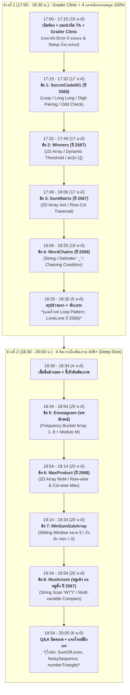

# แผนการสอนและคัดเลือกโจทย์ติวสอบ Grader วิชา คพ.102 (CS102) [ฉบับ Grader Problems Latest]

เอกสารฉบับนี้จัดทำขึ้นสำหรับติวเตอร์และทีมพี่ TA ในการติวข้อสอบ Grader นักศึกษาชั้นปีที่ 1 รายวิชา **คพ.102 พื้นฐานการแก้ปัญหาและการโปรแกรมคอมพิวเตอร์** คณะวิทยาศาสตร์และเทคโนโลยี มหาวิทยาลัยธรรมศาสตร์ โดยคัดเลือกโจทย์จาก **คลังข้อสอบล่าสุด (Grader Problems Latest ปี 2567 – 2568)** คัดสรรข้อสอบจริง 8 ข้อหลัก + 3 ข้อเสริม ครอบคลุมเนื้อหาทุกเสาหลัก 100%

---

## 1. ยุทธศาสตร์การสอนและการจัดสรรเวลา

### ช่วงที่ 1: ปูพื้นฐาน Grader + 4 เสาหลักสำคัญ (17:00 – 18:30 น.)
> **สำหรับน้องที่ต้องกลับบ้านก่อน 18:30 น.:** ได้เห็นแนวคิดครบทุกเสาหลักของภาษา C ป้องกันข้อผิดพลาดที่ทำให้ได้ 0 คะแนนใน Grader
- **เปิดคลาส & Grader Clinic (15 นาที):** แนะนำทีม TA แบ่ง 3 โซนดูแล + สาธิตข้อผิดพลาด 0 คะแนนยอดฮิต (CE, WA, PE, RTE)
- **4 ข้อหลัก (สูตร 10 + 7 นาทีต่อข้อ):**
  - **ติวเตอร์นำบนเวที (10–11 นาที):** แกะโจทย์ + วาด Logic Flow + Live Coding สด + ชี้จุดตาย Grader
  - **น้องพิมพ์ตามจริง + พี่ TA ประกบ (6–7 นาที):** เติมโค้ดใน Starter Template และทดสอบส่ง

### ช่วงที่ 2: 4 ข้อเจาะลึกตัดเกรด A/B+ (18:30 – 20:00 น.)
> **สำหรับน้องที่อยู่ต่อเพื่อลุยโจทย์ตัดเกรด:** ตรรกะหลายชั้น อัลกอริทึมซับซ้อน และกับดักข้อสอบ
- ใช้ **สูตร 12 + 8 นาทีต่อข้อ** (ติวเตอร์ 12 นาที + น้องลงมือทำ 8 นาที)

---

## 2. ตารางแผนการสอนภาพรวม (คัดจาก Grader Problems Latest)

---

## 3. รายละเอียดเนื้อหาช่วงที่ 1: 17.00 – 18.30 น. (4 เสาหลักครอบคลุม 100%)

### 🛠️ [17:00 - 17:15 น.] เปิดคลาส, แนะนำทีม TA และ Grader Clinic (15 นาที)

1. **แนะนำทีมงาน TA & กติกาห้องเรียนใหญ่ (4 นาที):**
   - **การแบ่งโซน:** Zone A (ซ้าย), Zone B (กลาง), Zone C (ขวา) และ TA โซนแถวหลัง
   - **กติกาการยกมือ:** ยกมือค้างไว้ พี่ TA ประจำโซนจะเดินเข้าไปประกบ
   - **TA Guideline:** ไม่พิมพ์โค้ดแทนน้อง, ชี้จุด Typo/Syntax, ตั้งคำถามชี้นำ Logic, ดูแลปัญหาสภาพแวดล้อม (GCC, Terminal, UTF-8)
2. **Grader Clinic ถอดรหัส 0 คะแนน (8 นาที):**
   - **PE (Presentation Error):** มีข้อความ Prompt ขยะ (`printf("Enter: ");`), ลืมขึ้นบรรทัดใหม่ `\n` ท้ายคำตอบ, เว้นวรรคเกินท้ายบรรทัด
   - **CE (Compilation Error):** สับสน `%lf` กับ `%f` ใน `scanf`, ลืม `#include`, เผลอใช้ syntax C++
   - **WA (Wrong Answer):** Integer Division (`75 / 100 == 0`), ลืมใส่ Header comment (Name/SID) ของ มธ., ลืมเคลียร์ค่าตัวแปรสะสม (`sum = 0;`)
   - **RTE & TLE:** จอง Array พอดีเกินไปจนหลุด Index, ลืม `&` ใน `scanf`, Infinite loop ใน `while`
3. **Flow ส่ง Grader ที่ปลอดภัย (3 นาที):** Local Test $\rightarrow$ Edge Case Test $\rightarrow$ Clean up debug `printf` ก่อนส่ง

---

### ข้อ 1: รหัสลับ001 (SecretCode001) — [17:15 - 17:32 น.] (17 นาที)
*ที่มา: ข้อสอบปฏิบัติการเขียนโปรแกรมครั้งที่ 1 (ปีการศึกษา 2568)*
- **เสาหลัก:** Loop, Modulo, Integer Arithmetic, Long Long Data Type / String Scan
- **โจทย์ย่อ:** รับเลขจำนวนเต็ม $T$ ($2 \le T \le 10^{15}$) จับคู่เลขโดดทีละ 2 ตัว $(b_i, p_i)$ แล้วคำนวณ $S_T = \sum (b_i - p_i)^4$ ถ้าจำนวนหลักเป็นเลขคี่ ให้ตอบ `INVALID TEXT`
- **แนวคิดการสอน (10 นาที):**
  1. ชี้เรื่องประเภทข้อมูล: $T \le 10^{15}$ เกินขนาด `int` (สูงสุด $\approx 2 \times 10^9$) ต้องใช้ `long long int` รับด้วย `%lld` หรือรับเป็น String `char str[25]`
  2. การตรวจเงื่อนไขจำนวนหลักคี่: ถ้าใช้ String ตรวจ `strlen(str) % 2 != 0` จะง่ายและตรงไปตรงมาที่สุด!
  3. วนลูปทีละ 2 ตำแหน่ง (`i += 2`): แปลงตัวอักษรเป็นตัวเลข `diff = str[i] - str[i+1]` แล้วบวกผลยกกำลัง 4 `diff * diff * diff * diff`
- **น้องลงมือทำ + TA ประกบ (7 นาที):** ฝึกรับ String และคำนวณเลขยกกำลัง พี่ TA เช็คคนที่ลืมเช็คหลักคี่

---

### ข้อ 2: เข้ารอบกี่คน (Winners) — [17:32 - 17:49 น.] (17 นาที)
*ที่มา: ข้อสอบเขียนโปรแกรมครั้งที่ 2 (ปีการศึกษา 2567)*
- **เสาหลัก:** 1D Array, Dynamic Threshold, Linear Traversal, Edge Condition
- **โจทย์ย่อ:** รับจำนวนผู้เล่น $N$ ($3 \le N \le 13$) และแต้มลูกเต๋าของแต่ละคน ผู้เล่นที่มีแต้ม **มากกว่าแต้มของคนสุดท้าย** จะผ่านเข้ารอบ แต่ถ้าไม่มีใครแต้มมากกว่าเลย คนสุดท้ายจะได้เข้ารอบ (ตอบ 1 คน)
- **แนวคิดการสอน (10 นาที):**
  1. การใช้อาร์เรย์ 1 มิติเก็บคะแนน `int scores[20];`
  2. การดึงแต้มคนสุดท้ายออกมาเป็นเกณฑ์: `int threshold = scores[n - 1];`
  3. วนลูปนับคนที่มี `scores[i] > threshold`
  4. กับดักโจทย์: ถ้า `count == 0` ให้ปรับ `count = 1` ตามกฎพิเศษของคนสุดท้าย!
- **น้องลงมือทำ + TA ประกบ (7 นาที):** ฝึกเก็บข้อมูลใน 1D Array และตรวจสอบเงื่อนไขขอบเขต

---

### ข้อ 3: คำนวณผลบวกในเมทริกซ์ (SumMatrix) — [17:49 - 18:06 น.] (17 นาที)
*ที่มา: ข้อสอบเขียนโปรแกรมครั้งที่ 2 (ปีการศึกษา 2567)*
- **เสาหลัก:** 2D Array, Nested Loop สำหรับรับตาราง $4 \times 4$, การวิ่งแถวและคอลัมน์
- **โจทย์ย่อ:** รับเมทริกซ์ $4 \times 4$ แล้วรับพิกัดเป้าหมาย $(r, c)$ หาผลรวมสมาชิกแถว $r$ + ผลรวมสมาชิกคอลัมน์ $c$
- **แนวคิดการสอน (10 นาที):**
  1. การประกาศและวนลูปรับค่าเมทริกซ์ 2 มิติ `matrix[4][4]` ด้วย Nested Loop ซ้อน 2 ชั้น
  2. ความแตกต่างระหว่าง:
     - แถวคงที่ วิ่งคอลัมน์: `matrix[r][j]` (เมื่อ $j = 0..3$)
     - คอลัมน์คงที่ วิ่งแถว: `matrix[i][c]` (เมื่อ $i = 0..3$)
  3. ชี้จุดที่ตัวตัด `(r, c)` จะถูกบวก 2 ครั้งตามที่โจทย์ระบุ
- **น้องลงมือทำ + TA ประกบ (7 นาที):** ตรวจสอบ Indexing `[row][col]` ไม่ให้สลับตำแหน่ง

---

### ข้อ 4: โซ่คำ (WordChains) — [18:06 - 18:25 น.] (19 นาที)
*ที่มา: ข้อสอบปฏิบัติการเขียนโปรแกรมครั้งที่ 2 (ปีการศึกษา 2568 ล่าสุด!)*
- **เสาหลัก:** Strings, Delimiter `_`, String Scanning, Adjacent Word Comparison
- **โจทย์ย่อ:** รับข้อความที่คำคั่นด้วย `_` ตรวจสอบว่ามีกี่คำ และมีกี่ "โซ่คำ" (โซ่คำคือคำที่ตัวสุดท้ายของคำก่อนหน้า ตรงกับตัวแรกของคำถัดไป)
- **แนวคิดการสอน (11 นาที):**
  1. การหาจำนวนคำทั้งหมด: เท่ากับ (จำนวนเครื่องหมาย `_`) + 1
  2. การหาจุดเชื่อมโซ่คำ: เมื่อเจอ `_` ที่ตำแหน่ง $i$
     - ตัวอักษรสุดท้ายของคำหน้าคือ `str[i - 1]`
     - ตัวอักษรแรกของคำถัดไปคือ `str[i + 1]`
     - ถ้า `str[i - 1] == str[i + 1]` แสดงว่าคำเชื่อมต่อกันในโซ่เดิม!
     - ถ้า **ไม่เท่ากัน** แสดงว่าโซ่เดิมขาด เกิดโซ่คำใหม่เพิ่มขึ้น 1 โซ่!
  3. ตั้งต้นจำนวนโซ่ `chains = 1;` ทุกครั้งที่รอยต่อไม่เท่ากัน ให้ `chains++;`
- **น้องลงมือทำ + TA ประกบ (8 นาที):** ฝึกไล่ Index ของ String และตรวจรอยต่อระหว่างคำ

*(ข้อเสริม Warm-up ลูปสำหรับฝึกพิมพ์: [LoveLove (TH).pdf](file:///c:/Users/Windows%2011/Desktop/University/Year2Semester1/CS102_Tutor/Problems/Grader%20Problems%20Latest/LoveLove%20(TH).pdf) วนพิมพ์ "Love" ขนาด $R \times C$)*

---

## 4. รายละเอียดเนื้อหาช่วงที่ 2: 18.30 – 20.00 น. (4 ข้อตัดเกรด A/B+)

### ข้อ 5: นพลักษณ์ (Enneagram) — [18:34 - 18:54 น.] (20 นาที)
*ที่มา: ข้อสอบปฏิบัติการเขียนโปรแกรม (Enneagram)*
- **ทักษะขั้นสูง:** Frequency Bucket Array, Modulo Arithmetic, Optimization
- **โจทย์ย่อ:** นักศึกษา $N$ คน มีรหัสลักษณ์ $1..9$ แบ่งกลุ่มละ $M$ คน โดยแต่ละกลุ่มต้องมีลักษณ์เดียวกัน คนที่จับกลุ่มไม่ได้ถือว่าไม่มีกลุ่ม หาว่ามีคนไม่มีกลุ่มรวมกี่คน
- **แนวคิดการสอน (12 นาที):**
  1. ทำไมไม่ควรใช้วิธีวนลูปค้นหาซ้ำซ้อน: การใช้ **Frequency Array (Bucket Array)** ขนาด 10 ช่อง `int freq[10] = {0};`
  2. เมื่อรับค่าลักษณ์ `val` ให้นับความถี่ทันที: `freq[val]++;`
  3. จำนวนคนที่เหลือเศษของแต่ละลักษณ์คือ `freq[i] % M`
  4. รวมผลลัพธ์ด้วยลูปเดียว: `total_leftover += freq[i] % M;` (เวลาทำงาน $O(N)$ รวดเร็วและกระชับที่สุด)
- **น้องลงมือทำ + TA ประกบ (8 นาที):** พี่ TA เน้นย้ำการเคลียร์อาเรย์เป็น 0 ตอนเริ่มต้น

---

### ข้อ 6: ผลคูณของเวกเตอร์ที่สูงที่สุด (MaxProduct) — [18:54 - 19:14 น.] (20 นาที)
*ที่มา: ข้อสอบปฏิบัติการเขียนโปรแกรมครั้งที่ 2 (ปีการศึกษา 2568 ล่าสุด!)*
- **ทักษะขั้นสูง:** 2D Array ขนาด $M \times M$, การหา Row Sum และ Column Sum, Multi-pass Max Tracking
- **โจทย์ย่อ:** รับเมทริกซ์ $M \times M$ ($2 < M < 20$) หาผลบวกแถวที่มากที่สุด (`max_row_sum`) และผลบวกคอลัมน์ที่มากที่สุด (`max_col_sum`) นำทั้งสองค่ามาคูณกัน
- **แนวคิดการสอน (12 นาที):**
  1. การคำนวณผลรวมแถว: วนลูปนอกแถว $i$, ลูปในคอลัมน์ $j$ สะสม `row_sum` แล้วเทียบหาค่าสูงสุด
  2. การคำนวณผลรวมคอลัมน์: วนลูปนอกคอลัมน์ $j$, ลูปในแถว $i$ สะสม `col_sum` แล้วเทียบหาค่าสูงสุด
  3. หรือสามารถคำนวณทั้ง 2 อย่างพร้อมกันในลูปเดียวโดยใช้ Array พักผลรวม `r_sum[M]` และ `c_sum[M]`
  4. ผลลัพธ์สุดท้ายคือ `max_row * max_col`
- **น้องลงมือทำ + TA ประกบ (8 นาที):** พี่ TA เช็คจุดที่น้องลืมรีเซ็ต `row_sum = 0` ก่อนเริ่มแถวใหม่

---

### ข้อ 7: ผลบวกน้อยที่สุดของอาร์เรย์ย่อย (MinSumSubArray) — [19:14 - 19:34 น.] (20 นาที)
*ที่มา: ข้อสอบเขียนโปรแกรมครั้งที่ 2 (ปีการศึกษา 2566)*
- **ทักษะขั้นสูง:** Fixed Sliding Window (ขนาด 5), กับดักค่าติดลบ, การตั้งค่าเริ่มต้น
- **โจทย์ย่อ:** รับอาร์เรย์ $N$ ตัว (ค่า $-100$ ถึง $100$) หาผลบวกต่อเนื่อง 5 ตัวที่ **น้อยที่สุด**
- **แนวคิดการสอน (12 นาที):**
  1. **จุดตายระดับตำนาน: "ห้ามตั้ง `min_sum = 0;` เด็ดขาด!"**  
     เพราะถ้าทุกช่วงบวกกันได้ค่าบวกทั้งหมด (เช่น $10, 15, 20$) คำตอบจริงคือ $10$ แต่ถ้าตั้งต้น `0` จะตอบ `0` ทันทีและได้ 0 คะแนน!
  2. ค่าเริ่มต้นที่ถูกต้อง: ต้องคำนวณผลรวม 5 ตัวแรกจริง ๆ ก่อน: `min_sum = arr[0] + arr[1] + ... + arr[4];`
  3. เทคนิคเลื่อนหน้าต่าง (Sliding Window): `cur_sum = cur_sum + arr[i] - arr[i - 5];`
- **น้องลงมือทำ + TA ประกบ (8 นาที):** พี่ TA ตรวจดูค่าเริ่มต้นของ `min_sum` ของน้องทุกคน

---

### ข้อ 8: เห็ดป่า หมูเด้ง vs หมูดึ๋ง (Mushroom) — [19:34 - 19:54 น.] (20 นาที)
*ที่มา: ข้อสอบปฏิบัติการเขียนโปรแกรมครั้งที่ 1 (ปีการศึกษา 2567)*
- **ทักษะขั้นสูง:** String Character Scanning, Uppercase Delimiter, Logic Simulation
- **โจทย์ย่อ:** รับสตริง 2 บรรทัด (ของหมูเด้ง และหมูดึ๋ง) ประกอบด้วยชื่อสีเห็ดต่อกันโดยไม่เว้นวรรค ทั้งสองจะกินเฉพาะเห็ด White และ Yellow เท่านั้น บอกว่าใครกินมากกว่ากัน (1=หมูเด้ง, 2=หมูดึ๋ง, 0=เท่ากัน) และมากกว่ากันกี่ดอก
- **แนวคิดการสอน (12 นาที):**
  1. การสังเกตข้อกำหนดของโจทย์ (Pattern Recognition):
     - สีทั้งหมด: Blue, Black, Green, Orange, Pink, Purple, Red, White, Yellow
     - ทุกสีขึ้นต้นด้วยตัวพิมพ์ใหญ่ และ **ไม่มีสีอื่นที่ขึ้นต้นด้วย 'W' หรือ 'Y' เลย!**
     - ดังนั้น การนับเห็ด White และ Yellow ก็คือ **การนับจำนวนตัวอักษร 'W' และ 'Y' ในสตริง!**
  2. เขียนฟังก์ชันย่อย `int count_edible(char str[])` วนนับ `str[i] == 'W' || str[i] == 'Y'`
  3. เปรียบเทียบผลลัพธ์ระหว่าง 2 ตัว และแสดงผลต่าง `abs(c1 - c2)`
- **น้องลงมือทำ + TA ประกบ (8 นาที):** สนุกกับโจทย์จริงที่เชื่อมโยงกับเรื่องใกล้ตัว

---

### 🎁 โจทย์โบนัสสำหรับฝึกทำเองที่บ้าน (Bonus & Challenge)
1. **[SumOfLoves (TH).pdf](file:///c:/Users/Windows%2011/Desktop/University/Year2Semester1/CS102_Tutor/Problems/Grader%20Problems%20Latest/SumOfLoves%20(TH).pdf):** ฝึกรับ String ที่มีช่องว่างด้วย `scanf("%[^\n]", str)` และคำนวณตำแหน่งตัวอักษร (A=1 .. Space=27)
2. **[NoisySequence (TH).pdf](file:///c:/Users/Windows%2011/Desktop/University/Year2Semester1/CS102_Tutor/Problems/Grader%20Problems%20Latest/NoisySequence%20(TH).pdf):** ลำดับคลื่นพลังจิตถูกรบกวน ($N \le 100,000$) สำหรับฝึก State Machine และสตรีมมิ่งข้อมูล
3. **[numberTriangle (TH).pdf](file:///c:/Users/Windows%2011/Desktop/University/Year2Semester1/CS102_Tutor/Problems/Grader%20Problems%20Latest/numberTriangle%20(TH).pdf):** ฝึก Nested Loop พิมพ์แพทเทิร์นสามเหลี่ยมตัวเลขแบบ Modulo wrap-around

---

## 5. ตารางสรุปการครอบคลุมเนื้อหา (Coverage Matrix 100%)

| หัวข้อหลักในข้อสอบ CS102 | โจทย์ที่ใช้สอน | จุดเน้นและทักษะสำคัญ |
| :--- | :--- | :--- |
| **Data Types & Large Int** | `SecretCode001` (2568) | `long long int`, `%lld`, การตรวจสอบหลักคี่ |
| **Loop & Modulo Math** | `SecretCode001` / `numberTriangle` | วนลูปทีละ 2 หลัก, Modulo arithmetic |
| **1D Array Basic** | `Winners` (2567) | การเข้าถึงสมาชิกอาร์เรย์, Threshold `arr[n-1]` |
| **1D Array Accumulator** | `LovelyVoters` / `Enneagram` | การสะสมคะแนนลง Bucket Array ตาม Index |
| **2D Array Traversal** | `SumMatrix` (2567) | วิ่งแถวคงที่ `m[r][j]` และวิ่งหลักคงที่ `m[i][c]` |
| **2D Array Matrix Search** | `MaxProduct` (2568) | คำนวณผลรวมทุกแถวและคอลัมน์ หาผลคูณสูงสุด |
| **String Basic & Delimiter** | `WordChains` (2568) | สตริงคั่นด้วย `_`, การเปรียบเทียบตัวอักษรติดกัน |
| **String Advanced Scan** | `Mushroom` (2567) / `SumOfLoves` | นับตัวอักษรเฉพาะ, การรับ String มีช่องว่าง |
| **Frequency Array** | `Enneagram` | นับความถี่ 1..9, การหาเศษกลุ่มด้วย `% M` |
| **Sliding Window & Traps** | `MinSumSubArray` | หน้าต่างเลื่อนขนาด 5, กับดัก `min = 0` |
